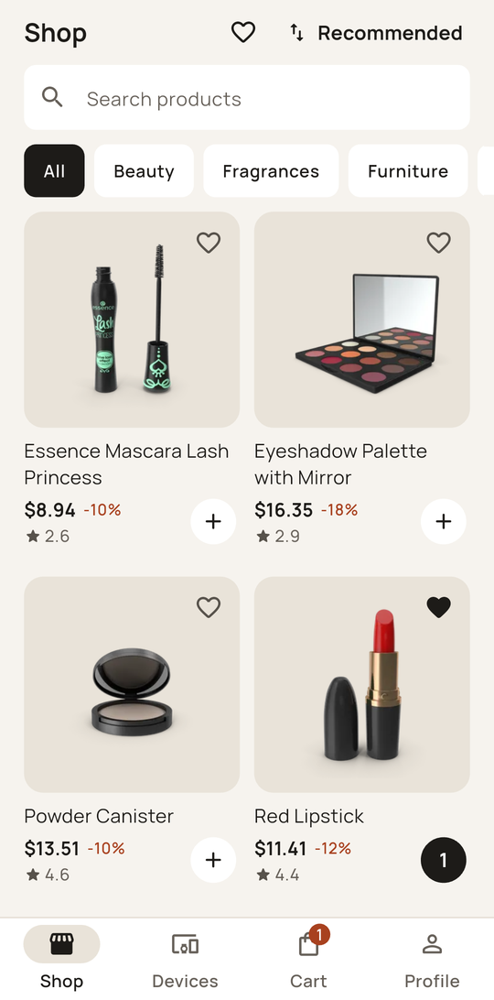
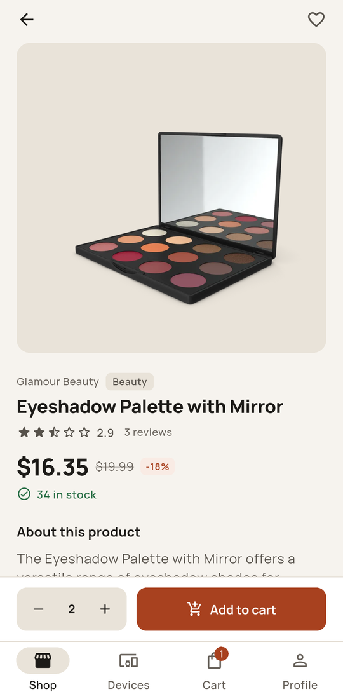
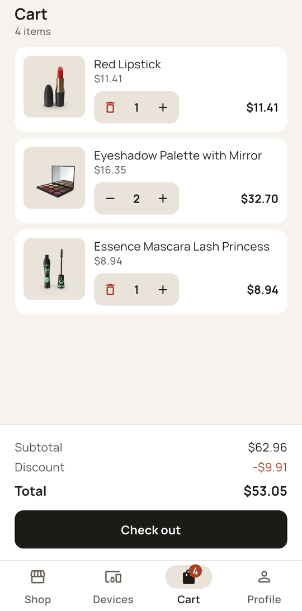
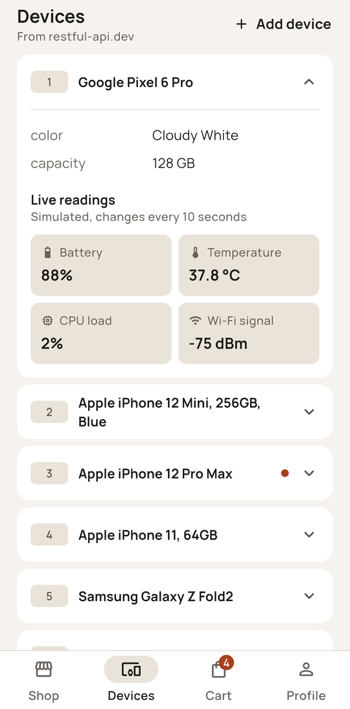

# Vitrine

[](https://github.com/HBProductionOfficial/Vitrine/actions/workflows/ci.yml)

Vitrine is a Flutter app with a small shop and a live device list. It signs in against [DummyJSON](https://dummyjson.com), sells from its 194-product sample catalog, and shows simulated sensor readings for devices from [restful-api.dev](https://restful-api.dev).

**Try it:** the [web demo](https://hbproductionofficial.github.io/Vitrine/), or the APK on the [Releases](https://github.com/HBProductionOfficial/Vitrine/releases) page (`vitrine-arm64-v8a.apk` fits almost any recent phone). The demo account is `emilys` / `emilyspass`, and the login screen can fill it in for you.

<p align="center">
  
  
  
  
</p>

## Background

I started this as a take-home assignment for a Flutter job in November 2025. The brief asked for biometric login and a device list from restful-api.dev with a few specific behaviours:

- one row open at a time, with the open row scrolled fully into view
- a simulated update every 10 seconds that makes a changed value blink in an open row
- a dot on closed rows that changed, which clears when you open them
- clean architecture, plus tests for the login and the API calls

In October 2026 I rebuilt it from an empty project and kept going. The login is real now, and there's a shop, a cart and settings in three languages. The device list still behaves the way the brief describes.

## About the commit dates

The commit dates in this repository, 8 to 21 September 2025, are simulated and don't record when the work was done. The commits were made in October 2026. This copy keeps their order, messages and contents, re-dates them across two weeks for demonstration, and the original history is kept separately.

## Features

- **Sign in** uses DummyJSON tokens, which refresh on their own when they expire. You can stay signed in, or unlock with a fingerprint or face after one password sign-in.
- **Shop** loads 20 products at a time and has search, categories and sorting. Each product page has a photo gallery, stock, shipping details and reviews, and you can add a review of your own.
- **Cart and saved items** stay on the device, separately for each account. You can add straight from the grid, pick an amount on the product page, and change it there or in the cart. Checkout sends the order to DummyJSON, and Profile has an order history: orders placed in the app plus the demo account's own history from DummyJSON.
- **Devices** keeps the assignment's accordion and live readings, and you can add, edit and delete your own devices.
- **Settings** cover English, Georgian and Russian, light and dark themes, and biometric sign-in.

On a phone the tabs sit at the bottom. On tablets and the web they move to a side rail and the content stays centred.

## How it's built

Flutter 3.35 with Riverpod 3 for state, go_router for navigation and Dio for HTTP.

```
lib/src/
  core/        theme, networking, storage, biometrics, shared widgets
  features/
    auth/      data/  domain/  presentation/
    devices/
    shop/
    cart/
    orders/
    saved/
    profile/
    settings/
    shell/     bottom bar and side rail
```

Each feature splits into three layers. `data` talks to the API, `domain` holds plain models and repository interfaces, and `presentation` has the Riverpod notifiers and the screens. Notifiers only see repository interfaces, so the tests can hand them fakes.

## Things to know

- DummyJSON doesn't store anything you send. Sign-up, password reset and orders get a believable response, and the app tells you nothing was saved. It has no way to post a review at all, so reviews you write stay on the phone, and so do the orders you place.
- restful-api.dev allows about 50 requests a day. The app caches the device list and shows the saved copy with a note when the limit is reached. The 13 sample devices are read-only, so Edit and Delete only appear on devices you added.
- Android tells apps how strong a phone's biometrics are, not whether they're a face or a fingerprint. The app asks the system which sensors exist and labels the button to match, for example "Sign in with face or fingerprint". The system prompt still picks the method, and some phones, many Samsungs among them, only let apps use the fingerprint even though face unlock works on the lock screen.
- Without a sensor the app shows no biometric option at all. With a sensor but nothing set up on it, the sign-in button stays hidden and Settings says what to add.
- The web build has no biometric sign-in.
- Sorting uses DummyJSON's list price, but the grid shows the price after discount, so two neighbours can look a few cents out of order.
- The release APK is signed with the debug key. It installs from the file but isn't ready for an app store.

## Running it locally

```sh
flutter pub get
flutter run
```

`flutter test` runs 99 unit and widget tests. They cover sign-in and session restore, the biometric checks, the token refresh, the device list (including the dot and the blink), the shop's paging and search, the cart totals, orders and your own reviews.

The end-to-end tests in `integration_test/` drive the whole app on a phone or emulator:

```sh
flutter test integration_test -d <device id>
```

They search, add to the cart, change the amount and check out; watch a device's readings change; and try a wrong password and a server that drops out and comes back. Instead of the public APIs they talk to a fake server built from real captured responses, so the results don't depend on DummyJSON being up or on restful-api.dev's daily limit. CI runs them on an Android 14 emulator.

The app icon is drawn in code by the same painter as the logo on the login screen. `tool/render_icon.dart` has the two commands that regenerate it.

## License

[MIT](LICENSE)
